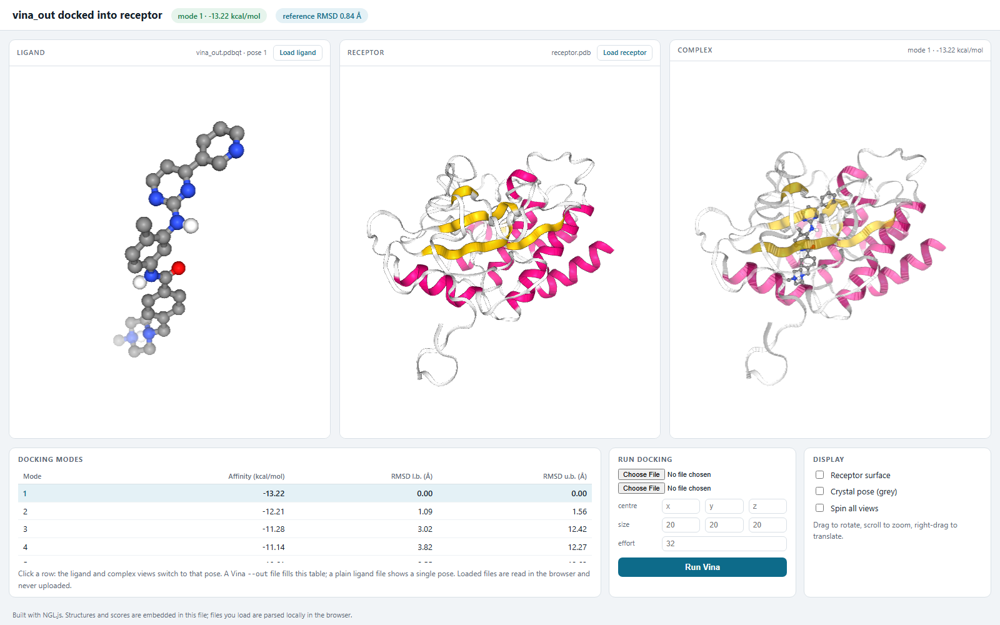

# ligand_docking

Dock a small molecule into a protein with AutoDock Vina from Python, then look at
the result in a static 3D page: ligand on its own, receptor on its own, and the
complex, with the score table beside them.

No server is involved. The viewer is one HTML file plus two JavaScript files, and
it opens by double-click. AutoDock Vina stays the docking engine — this package
prepares nothing and re-implements nothing, it runs the official binary and reads
what it writes.

## What is here

| Path | Contents |
| --- | --- |
| `ligand_docking/pdbqt.py` | PDBQT → PDB conversion, Vina output parsing, RMSD to a reference pose |
| `ligand_docking/dock.py` | Locates the Vina executable and runs it, returns parsed poses |
| `ligand_docking/report.py` | Writes the standalone viewer page and copies its assets |
| `ligand_docking/cli.py` | `ligand-docking dock` and `ligand-docking view` |
| `ligand_docking/viewer/` | The page template, NGL.js and the PDBQT parser used in the browser |
| `examples/1iep/` | Imatinib and Abl kinase (PDB 1IEP), the official Vina example |

## Install

```
pip install -e .
```

Only the standard library is required for the viewer. `numpy` adds a proper
RMSD for the reference pose (`pip install numpy`), otherwise a translation-only
estimate is used.

AutoDock Vina 1.2.7 is bundled in `bin/`, so a run works out of the box on
Windows, Linux and macOS with no extra download:

| File | Platform |
| --- | --- |
| `bin/vina_win.exe` | Windows x86_64 |
| `bin/vina_linux_x86_64` | Linux x86_64 |
| `bin/vina_mac_x86_64` | macOS Intel |
| `bin/vina_mac_aarch64` | macOS Apple silicon |

The package picks the right one for the machine, and sets the executable bit on
POSIX if a checkout lost it. `ligand-docking vina` prints which binary will be
used. To use your own build, pass `--vina /path/to/vina` or set the `VINA_EXE`
environment variable; both win over the bundled files. On Linux aarch64, drop a
`bin/vina_linux_aarch64` from the same release and it is picked up.

The binaries are unmodified files from the
[AutoDock Vina 1.2.7 release](https://github.com/ccsb-scripps/AutoDock-Vina/releases/tag/v1.2.7)
and are redistributed under the Apache License 2.0 — see
`bin/LICENSE-AutoDock-Vina`. They are third-party executables: on macOS, download
them with a browser or run `xattr -d com.apple.quarantine bin/vina_mac_*` if
Gatekeeper refuses to start them.

## Prepare the inputs

Both files must be PDBQT. [Meeko](https://meeko.readthedocs.io/) is the official
Python tool for that:

```
pip install meeko rdkit
mk_prepare_receptor.py --read_pdb protein.pdb -o receptor -p -v \
    --box_size 20 20 20 --box_center 15.19 53.90 16.92
mk_prepare_ligand.py -i ligand.sdf -o ligand.pdbqt
```

Keep the `receptor.box.txt` that `mk_prepare_receptor.py` writes with `-v`; it is
the config file for the run below.

## Dock

```
ligand-docking dock --receptor receptor.pdbqt --ligand ligand.pdbqt \
    --config receptor.box.txt --exhaustiveness 32 \
    -o run_out.pdbqt --html run.html --open
```

or give the box directly:

```
ligand-docking dock --receptor receptor.pdbqt --ligand ligand.pdbqt \
    --center 15.19 53.90 16.92 --size 20 20 20 --html run.html
```

| Option | Default | Meaning |
| --- | --- | --- |
| `--receptor`, `--ligand` | required | prepared PDBQT files |
| `-o`, `--out` | `<ligand>_out.pdbqt` | Vina output file |
| `--config` | none | Vina config file with the search box |
| `--center`, `--size` | none | search box, used when there is no `--config` |
| `--exhaustiveness` | `32` | search effort |
| `--num-modes` | `9` | poses to keep |
| `--seed` | `42` | random seed, so runs are repeatable |
| `--cpu` | `0` | `0` uses every core |
| `--vina` | auto | path to the Vina executable |
| `--html` | none | also write the viewer page |
| `--crystal` | none | reference ligand for the RMSD badge |
| `--open` | off | open the viewer when it is written |

## Run a docking from the browser

A static page cannot start a program, so `serve` starts a small local server
(loopback only) and the page gains a **Run docking** panel:

```
ligand-docking serve --receptor receptor.pdb --poses run_out.pdbqt --open
```

Then, on the page: choose a receptor PDBQT and a ligand PDBQT, type the box
centre and size, press **Run Vina**. The poses and the score table are replaced
with the new result; nothing is uploaded anywhere, the files go from your browser
to the local server on 127.0.0.1.

| Option | Default | Meaning |
| --- | --- | --- |
| `--receptor`, `--poses` | required | what the page shows first |
| `--crystal` | none | reference ligand for the RMSD badge |
| `--title`, `--subtitle` | from file names | header text |
| `--port`, `--host` | `8766`, `127.0.0.1` | where the server listens |
| `--workdir` | `./.ligand-docking-tmp` | run folders for the docking jobs |
| `--vina` | bundled binary | path to the Vina executable |
| `--open` | off | open the page when the server is ready |

The work folder has to be writable by the Vina process, which is why it defaults
to the current directory rather than the system temp folder.

## View an existing run

```
ligand-docking view --receptor receptor.pdb --poses run_out.pdbqt \
    --crystal ligand.pdbqt -o run.html --open
```

`--poses` accepts a Vina `--out` file (scores and all poses) or a single ligand
file (`.sdf`, `.mol2`, `.pdb`, `.pdbqt`), which gives one pose and an empty score
table.

## What the page shows



- **Ligand** — the pose on its own, ball and stick by element.
- **Receptor** — cartoon coloured by secondary structure.
- **Complex** — the same pose inside the pocket, with the camera framed on the
  binding site.
- **Docking modes** — affinity and RMSD l.b./u.b. per pose; click a row to switch
  all views to that pose.
- **Display** — receptor surface, the reference pose in grey, and spin.
- **Load your own files** — drop in a receptor and a ligand or Vina output from
  disk; they are parsed in the browser and never uploaded.

## Licence

MIT, see [LICENSE](LICENSE).
